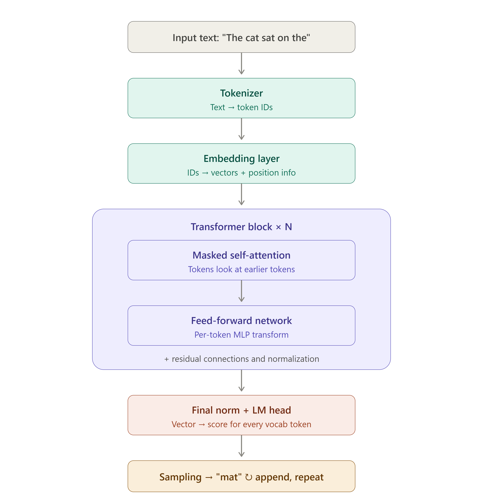

# basic-llm

A modern decoder-only language model built from scratch twice: first in
pure NumPy with hand-derived gradients for every layer, then ported to
PyTorch and trained end-to-end on a single 12 GB consumer GPU.



The architecture follows current open models (Llama / Qwen family):
byte-level BPE tokenizer → token embeddings → N × pre-norm transformer
blocks (RMSNorm, RoPE, grouped-query attention, SwiGLU FFN) → final norm →
tied LM head, with KV-cached sampling at inference.

## Repository layout

| Path | What it is |
|------|------------|
| [`numpy/`](numpy/) | The from-scratch implementation. One concept per file, each with a long explanatory docstring and gradients checked numerically. Read in roughly the order below. |
| [`pytorch/`](pytorch/) | The production port: a single-file trainer (`train_gpt.py`), data-prep scripts, presets from 0.9M to ~113M parameters, Docker support, and full docs. |

### `numpy/`, in learning order

1. `bpe_tokenizer.py` → `bpe_tokenizer_v2.py`: byte-level BPE, then GPT-2-style regex pre-splitting
2. `embedding_layer.py`: token embeddings and positional encoding
3. `attention_layer.py`: masked multi-head self-attention
4. `rope.py`: rotary position embeddings
5. `gqa.py`: grouped-query / multi-query attention
6. `ffn_layer.py`: SwiGLU feed-forward
7. `full_model.py`: RMSNorm, stacked blocks, generation
8. `adam.py`, `lr_schedule.py`: AdamW and warmup + cosine decay
9. `kv_cache.py`, `sampling.py`: fast inference and decoding strategies
10. `checkpoint.py`, `shakespeare.py`, `shake_resume.py`: putting it all together on tiny Shakespeare

Each file runs standalone and needs only `numpy` and `regex`:

```bash
pip install -r numpy/requirements.txt     # or: uv run --with-requirements numpy/requirements.txt python ...
python numpy/attention_layer.py           # works from any directory
python numpy/shake_resume.py 500          # train 500 steps; rerun to resume
```

Scripts read the shared Shakespeare data (`shake_ids.npy`, `shake_merges.json`)
from `pytorch/` and write checkpoints and loss curves to `numpy/out/`
(git-ignored). See [`numpy/paths.py`](numpy/paths.py).

## Quickstart (PyTorch)

Requires [uv](https://docs.astral.sh/uv/).

```bash
cd pytorch
uv sync                                  # creates .venv, installs torch + numpy
uv run prepare-data                      # writes data/{train,val}.bin (Shakespeare)
uv run train-gpt --preset tiny           # 0.9M params, minutes on CPU or any GPU
uv run train-gpt --preset tiny --resume --sample_only \
    --merges shake_merges.json --prompt "ROMEO:"
```

> **Windows:** PyPI serves CPU-only PyTorch on Windows, so `pyproject.toml`
> pins PyTorch's CUDA index. See [`pytorch/README.md`](pytorch/README.md#gpu-wheel-pinning)
> if `torch.cuda.is_available()` returns `False`.

From there:

- [`pytorch/GUIDE.md`](pytorch/GUIDE.md): the short path from Shakespeare → TinyStories → FineWeb-Edu
- [`pytorch/RUNBOOK.md`](pytorch/RUNBOOK.md): a staged test-drive with expected numbers at every phase, plus troubleshooting
- [`pytorch/README.md`](pytorch/README.md): presets, real-data prep, plotting

## Results

The largest run so far trained a **113M-parameter** model on **1.9B tokens of
FineWeb-Edu** (SmolLM2's 49k-vocab tokenizer) on a single RTX 4070 SUPER:

| | |
|---|---|
| Final train / val loss | 3.245 / 3.262 (from 10.96) |
| Wall clock | 8h 38m |
| Throughput | ~61k tokens/s with `--compile` |

Full curves and samples are in [`pytorch/fineweb_training_report.html`](pytorch/fineweb_training_report.html)
(download it and open it in a browser; GitHub shows HTML as source). An
earlier TinyStories run is in [`pytorch/training_report.html`](pytorch/training_report.html).

Checkpoints and tokenized datasets are not committed (they're several GB);
the data-prep scripts regenerate the data.

## License

[MIT](LICENSE)
